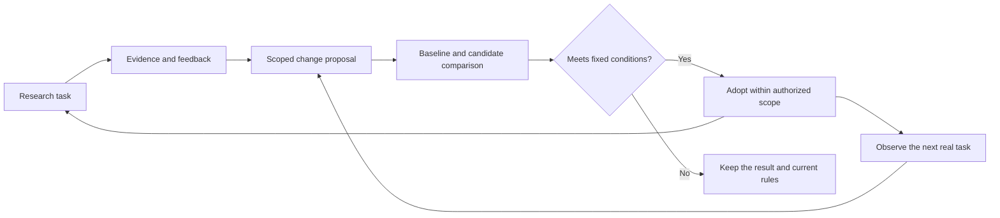

# A portable research workflow

This repository gives AI assistants a shared research procedure.
A harness is the application that runs an assistant and its tools.
The workflow keeps research progress in files so that another harness can continue the work.

The main source is [Research-Starter-Kit](https://github.com/LAMDA-NeSy/Research-Starter-Kit).
The package turns its advice into tasks, records, completion conditions, and return paths.
It also uses selected patterns from `karpathy/autoresearch` and `SakanaAI/AI-Scientist`.
Its workflow improvement procedure draws from Hermes and Pi.

The current scope is personal research, with detailed support for computational AI and machine learning.
The workflow covers study, questions, tests, writing, and discussion.
It does not include an experiment scheduler or model training framework.

## Start a research task

Open this repository in Codex, Claude Code, Gemini CLI, or OpenCode.
Use the prompt below and replace the values in angle brackets.
The target repository holds the research work, not the workflow package.

```text
Read skills/research-workflow/SKILL.md and use it for this task.
The target research repository is <path>.
My topic or seed paper is <topic or paper>.
My current task is <task>.
Use <language> for research records.
Read existing research records before creating new ones.
Start from the stage that the task needs.
```

For a new project, the assistant creates `research/STATE.md` and `research/BRIEF.md` in the target repository.
For an existing project, it reads those records and their evidence first.
For a standalone reading task, it creates only the requested output.

If the target uses another record layout, the assistant keeps that layout.
If a tool or source is unavailable, the assistant records the limit.
It must not turn an unrun experiment into a reported result.

## Set your preferences

The shared skill contains no personal defaults.
You can use it without a preferences file.
The assistant uses your request, project conventions, and supplied evidence.

For local defaults, copy the [preferences template](skills/research-workflow/templates/PREFERENCES.md) to `RESEARCH.local.md`.
Place this file in your harness workspace root.
The workspace root is the directory that you open in the harness.
You can also name another preferences file in your request.

Set choices such as the record language, primary paper library, and selected note location.
Paths in the preferences file start from that file's directory.
For configurable choices, the current request takes priority over project conventions, which take priority over local defaults.

This repository ignores `RESEARCH.local.md` in Git.
Other repositories need their own ignore rule before you save private defaults there.
Read the [preferences guide](skills/research-workflow/references/preferences.md) for scope and reuse across workspaces.

The [Zotero and Git example](skills/research-workflow/references/zotero-git-example.md) shows one reading setup.
The assistant applies it only when you select it.

## Choose the work

These are natural-language requests, not custom shell commands.
The skill selects the stage from your request and the saved evidence.
You can enter the workflow at any stage.

| Request | What the assistant does | Main output |
| --- | --- | --- |
| Start a project in this topic. | Define the goal, resources, limits, and next useful task. | Research brief and state. |
| Read this paper for my question. | Explain the problem, method, evidence, and open questions. | An existing note link or task-specific paper record. |
| Find the closest work. | Search sources and compare assumptions and results. | A literature record. |
| Analyze this collection with NotebookLM. | Track exports, imports, evidence coverage, and comparisons across batches. | A corpus record and source-linked synthesis. |
| Turn these observations into a question. | Compare explanations and define a testable hypothesis. | A question record. |
| Design the smallest useful test. | Fix the comparison, metrics, resources, and stop conditions. | An experiment plan. |
| Run this experiment within this budget. | Implement the test and preserve commands, code versions, and outputs. | An experiment record. |
| Analyze these results. | Assess the comparison and state what the evidence supports. | Analysis and a claims record. |
| Draft a paper from these records. | Build an argument that links each claim to evidence. | A draft, figures, and evidence gaps. |
| Prepare a meeting or response to reviewers. | Organize evidence, questions, responses, and next actions. | A review or discussion record. |
| Continue the project. | Inspect saved state, outputs, and active jobs before taking the next action. | Updated state and the requested work. |

## Analyze a large collection

The [bulk literature procedure](skills/research-workflow/references/bulk-literature.md) provides an optional Zotero, zpm, rclone, Google Drive, and NotebookLM workflow.
It supports analysis across dozens or hundreds of selected papers through explicit batches and saved evidence.
It does not establish that every imported paper contributed to a generated answer.

Use this request after selecting a collection and analysis question:

```text
Use the research-workflow skill and its bulk literature procedure.
Analyze <collection> for <question> using NotebookLM.
The target research repository is <path>.
Use <export location>, <Drive destination>, and <notebook or notebook plan>.
Keep an inventory of paper identities, file versions, imports, and evidence coverage.
Save a synthesis with original-paper citations and unresolved gaps.
Use <time or usage budget> as the stopping limit.
```

The assistant first inspects existing records and available tools.
It preserves Zotero as the library when you choose this example.
The [corpus template](skills/research-workflow/templates/CORPUS.md) carries progress between harnesses and manual interface steps.
Other researchers can select their own tools and library conventions.

For terminal execution, use the [scripted pipeline guide](skills/research-workflow/references/scripted-bulk-literature.md).
The optional script uses the third-party `notebooklm-py` client and saves progress across runs.
It produces batch answers and citation records for source inspection.
It does not establish full reading or complete evidence coverage from generated answers alone.

## Follow the research loop

```text
S0 Scope -> S1 Study -> S2 Question -> S3 Design -> S4 Run -> S5 Analyze -> S6 Write
               ^           ^            ^                       |            |
               |           |            +-----------------------+------------+
               +-----------+------------------------------------+

S7 Review can run at any stage. Its decisions update the next action.
```

The loop returns to earlier stages when evidence changes the decision.
A failed run can require an implementation repair.
A negative result can support a decision to stop an approach.
Neither result disappears from the project history.

The [stage guide](skills/research-workflow/references/workflow.md) defines inputs, actions, outputs, completion conditions, and return paths.
These conditions test the evidence available for a decision.
They do not require user approval at every stage.

## Use files to continue the work

Research files are the shared record between harnesses.
The package keeps them separate from the skill's instructions.
Create each record only when its stage needs it.

```text
target-repository/
  research/
    STATE.md
    BRIEF.md
    LITERATURE.md
    CLAIMS.md
    MANUSCRIPT.md
    papers/
    questions/
    experiments/
    reviews/
```

Code, data, raw logs, and drafts can stay in their existing project directories.
The research records link to those files.
The state file records active jobs so that a new assistant does not launch duplicate work.

Use this prompt after switching harnesses:

```text
Read the research-workflow skill and research/STATE.md.
Read the records needed for the next action.
Make sure that recorded outputs and active jobs still exist.
Continue the current task within its saved limits.
Save the result and next action in the research records.
```

Browser sessions, credentials, tools, and permissions do not move with these files.
Each harness supplies its own tools.
Read the [harness guide](docs/harnesses.md) for entry files, copy instructions, and optional skill discovery.

## Improve the workflow

The research loop produces results and feedback.
A second loop uses that feedback to improve the procedure.
RSI means recursive self-improvement, or repeated improvement of the workflow itself.



You can give ideas in ordinary language.
The assistant separates temporary requests, local defaults, project conventions, and reusable rules.
These examples define different scopes:

| Request | Effect |
| --- | --- |
| Remember this automation idea for later. | Save a proposal without changing active instructions. |
| Use this library for my future reading tasks. | Save a local default without changing the shared skill. |
| Use Chinese notes for this project. | Record an adopted convention in this project's brief. |
| Try this procedure for the next paper only. | Record a local trial and its stop condition. |
| Make this procedure the default in this skill copy. | Test the change and update that package within the stated scope. |
| Review recent failures and improve one procedure. | Run one bounded round with fixed acceptance conditions. |

Use this prompt for a focused improvement round:

```text
Read skills/research-workflow/SKILL.md and its evolution procedure.
Use <evidence or change record> to improve <specific behavior>.
Edit only <package or project path>.
Try one candidate within <time or spending limit>.
Compare it with the saved baseline on the same tasks.
Adopt it in that scope if the fixed conditions and relevant regression cases pass.
Otherwise, keep the current rules and record the result.
Preserve research history and save a recovery path.
```

The [evolution procedure](skills/research-workflow/references/evolution.md) defines capture, comparison, adoption, observation, and rollback.
A rollback restores procedure text while preserving research history.
The [change template](skills/research-workflow/templates/CHANGE.md) records the evidence and decision.

Toolkit changes live in `changes/` in this repository.
Project trials live in `changes/` inside the selected research directory.
Only adopted conventions and the active trial enter task startup context.

The assistant runs this loop during an authorized session.
This package supplies no background worker or native Hermes or Pi extension.
A saved lesson or passing example does not establish general improvement.

## Develop this toolkit

Read the [contribution guide](CONTRIBUTING.md) for change scope, test evidence, and review requirements.
The [repository structure](docs/architecture.md) explains the shared package and local research data.

Use Git to preserve small, reviewable changes.
Use Conventional Commits for commit messages, such as `feat: add a reading procedure` or `fix: preserve active job state`.
Run the affected behavior cases before committing a procedure change.

Keep research data and local credentials outside toolkit commits.
Test behavior in temporary directories.
Use the [test results](tests/RESULTS.md) to distinguish observed behavior from untested claims.

## Read the package

The root files load one shared procedure.
The reusable skill contains all stage rules and templates.
Copy its complete directory when you use it in another repository.

| File or directory | Purpose |
| --- | --- |
| [AGENTS.md](AGENTS.md) | Shared project entry for research tasks. |
| [CLAUDE.md](CLAUDE.md) | Import of the shared entry for Claude Code. |
| [GEMINI.md](GEMINI.md) | Import of the shared entry for Gemini CLI. |
| [SKILL.md](skills/research-workflow/SKILL.md) | Task routing, records, tools, and session rules. |
| [Stage guide](skills/research-workflow/references/workflow.md) | Procedures for S0 through S7. |
| [Preferences guide](skills/research-workflow/references/preferences.md) | Optional local defaults and their scope. |
| [Evolution procedure](skills/research-workflow/references/evolution.md) | Scoped changes, fixed comparisons, adoption, and recovery. |
| [Templates](skills/research-workflow/templates/) | Starting files for real research records. |
| [Source map](skills/research-workflow/references/sources.md) | Guide coverage, repository references, and design choices. |
| [Behavior tests](tests/scenarios.md) | Small tasks for testing another harness. |
| [Evolution tests](tests/evolution.md) | Tasks that test scope, adoption decisions, and preservation of records. |
| [Test results](tests/RESULTS.md) | Observed behavior and the limits of the current tests. |

The package uses plain English for portable instructions.
The assistant uses your requested language for research records and conversation.
The source map distinguishes source advice from this package's added procedures.

## License

This toolkit uses the [MIT license](LICENSE).
The complete skill package includes its own [license copy](skills/research-workflow/LICENSE).
External tools and research sources retain their own licenses and terms.
